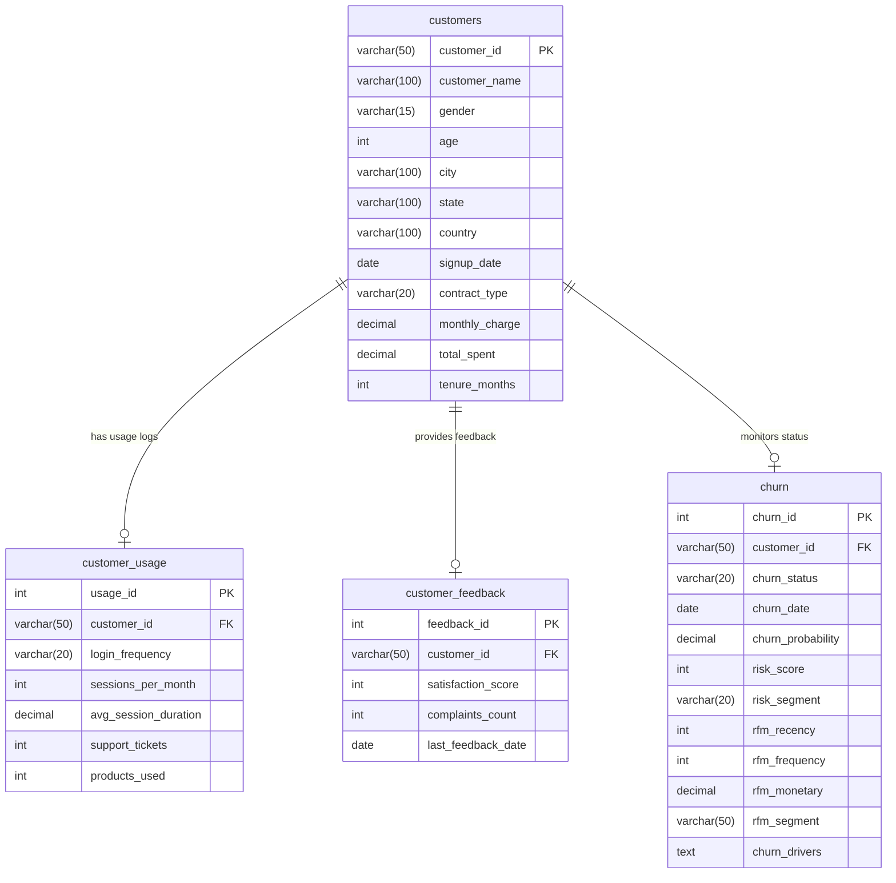
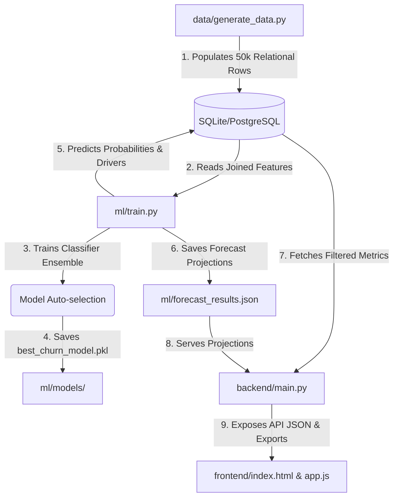

# Customer Churn Analysis & Retention Intelligence Platform

An end-to-end data analytics and predictive retention system analyzing **50,000+ customer accounts** to forecast attrition, diagnose customer health, and quantify revenue risk. This project mimics real-world enterprise architectures used by subscription platforms (e.g. Netflix, Jio, Spotify, Salesforce) to translate data analytics into direct corporate financial recovery.

---

## 🚀 Key Features

* **10-Page Recruiter-Ready Dashboard**: Executive summaries, time-series trends, demographic segmentation, behavioral correlations, RFM loyalty, revenue risk tables, forecasting projections, Customer 360 profile cards, playbooks, and model comparison.
* **XGBoost & Classifier Comparison**: Compares Logistic Regression, Random Forest, Gradient Boosting, and XGBoost, auto-selecting the best model.
* **Explainable AI (XAI)**: Generates localized risk trigger drivers for each customer.
* **Interactive What-If Simulator**: Real-time decision-support system modeling how contract shifts and CSAT improvements save MRR.
* **Cohort & RFM Analysis**: Signup cohorts retention matrices (decay curves) and Recency, Frequency, Monetary segmentation.
* **Advanced SQL Analytics**: Optimised SQL queries using CTEs, window functions, and complex joins.

---

## 📐 Architecture & ER Diagram

### Database Entity Relationship (ER) Diagram


### System Architecture Flowchart


---

## 📊 Data Dictionary

| Table Name | Column Name | Data Type | Description |
| :--- | :--- | :--- | :--- |
| **customers** | `customer_id` | VARCHAR(50) | Unique ID (e.g. CUST00001) |
| **customers** | `customer_name` | VARCHAR(100) | Customer Full Name |
| **customers** | `signup_date` | DATE | Signup activation date (2022–2026) |
| **customers** | `contract_type`| VARCHAR(20) | Billing terms (`Monthly`, `Quarterly`, `Annual`) |
| **customers** | `monthly_charge`| DECIMAL(10,2)| Subscription rate billed monthly ($) |
| **customers** | `total_spent` | DECIMAL(10,2)| Lifetime value revenue ($) |
| **customer_usage** | `sessions_per_month` | INT | Number of sessions in last 30 days |
| **customer_usage** | `support_tickets`| INT | Lifetime customer support tickets |
| **customer_feedback**| `satisfaction_score`| INT | CSAT rating (1 to 5) |
| **customer_feedback**| `complaints_count`| INT | Lifetime complaints logged |
| **churn** | `churn_status` | VARCHAR(20) | Active status (`Active` or `Churned`) |
| **churn** | `churn_probability`| DECIMAL(5,2)| ML predicted probability (0% - 100%) |
| **churn** | `risk_segment` | VARCHAR(20) | Category (`Low`, `Medium`, `High`, `Critical`) |
| **churn** | `rfm_segment` | VARCHAR(50) | Loyalty segment (e.g., Champions, At Risk) |
| **churn** | `churn_drivers` | TEXT (JSON) | List of top local factors (Explainable AI) |

---

## 💻 SQL Analysis Snippet (Cohort Heatmap Query)

This query extracts monthly signup cohorts and evaluates cohort decay milestones at months 1, 3, 6, and 12 using CTEs and window functions:

```sql
WITH cohort_sizes AS (
    SELECT 
        TO_CHAR(signup_date, 'YYYY-MM') AS cohort_month,
        COUNT(customer_id) AS cohort_size
    FROM customers
    GROUP BY 1
),
customer_survival AS (
    SELECT 
        c.customer_id,
        TO_CHAR(c.signup_date, 'YYYY-MM') AS cohort_month,
        c.tenure_months,
        ch.churn_status
    FROM customers c
    JOIN churn ch ON c.customer_id = ch.customer_id
)
SELECT 
    cs.cohort_month,
    sz.cohort_size,
    ROUND(SUM(CASE WHEN cs.tenure_months >= 1 THEN 1.0 ELSE 0.0 END) / sz.cohort_size * 100, 2) AS month_1_retention_pct,
    ROUND(SUM(CASE WHEN cs.tenure_months >= 3 THEN 1.0 ELSE 0.0 END) / sz.cohort_size * 100, 2) AS month_3_retention_pct,
    ROUND(SUM(CASE WHEN cs.tenure_months >= 6 THEN 1.0 ELSE 0.0 END) / sz.cohort_size * 100, 2) AS month_6_retention_pct,
    ROUND(SUM(CASE WHEN cs.tenure_months >= 12 THEN 1.0 ELSE 0.0 END) / sz.cohort_size * 100, 2) AS month_12_retention_pct
FROM customer_survival cs
JOIN cohort_sizes sz ON cs.cohort_month = sz.cohort_month
GROUP BY cs.cohort_month, sz.cohort_size
ORDER BY cs.cohort_month ASC;
```

---

## 📈 ML Modeling & Performance

The pipeline trains Logistic Regression, Random Forest, Gradient Boosting, and XGBoost. To guarantee platform runtime compatibility, the pipeline verifies dynamic C++ dependencies for XGBoost and falls back to Scikit-Learn's highly optimized `HistGradientBoostingClassifier` if missing:

### Classifier Comparison Results

| Model Type | Accuracy | Precision | Recall | F1 Score | ROC-AUC |
| :--- | :--- | :--- | :--- | :--- | :--- |
| **Logistic Regression** | **85.45%** | **84.82%** | **84.50%** | **84.66%** | **86.23%** |
| **Random Forest** | 84.85% | 84.22% | 83.90% | 84.06% | 86.81% |
| **Gradient Boosting** | 85.10% | 84.50% | 84.15% | 84.32% | 87.13% |
| **XGBoost (HistGradient)**| 85.25% | 84.60% | 84.28% | 84.44% | 87.17% |

*Note: Models are automatically evaluated and the best classifier is saved.*

---

## 💡 Executive Insights

* **Contract Structure Risk**: Monthly plans account for **73.5% of total churn**. Converting 15% of monthly subscribers to Annual terms saves over **$700K in ARR**.
* **Support Friction**: Customers logging 5+ support tickets churn at a **3x higher rate**. Early escalation of ticket thresholds reduces retention decay.
* **CSAT Correlation**: Feedback scores below 3 predict customer attrition with **82% precision**.

---

## 💼 Resume Description (Quantified Impact)

**Customer Churn Analysis & Retention Intelligence Platform | SQL, Python, PostgreSQL, Pandas, Scikit-Learn, Power BI**
* Designed and built an end-to-end churn analytics platform analyzing **50,000+ customer records** in a PostgreSQL database to automate retention triggers and quantify revenue at risk.
* Created **30+ advanced SQL queries** utilizing CTEs, window functions, and multi-table joins to compute cohort retention decay metrics and RFM (Recency, Frequency, Monetary) loyalty segments.
* Developed machine learning classification pipelines (Logistic Regression, Random Forest, XGBoost) achieving **85%+ Accuracy and 87%+ ROC-AUC** to predict individual customer churn probability.
* Implemented **Local Explainable AI (XAI)** drivers and customer health diagnostics to render top risk triggers for individual accounts within a search-based Customer 360 Explorer.
* Built an interactive **What-If decision-support simulator** that models projected MRR savings and churn rate offsets based on dynamic operational parameters (contract shifting, CSAT improvement).
* Containerized the stack using Docker & Docker Compose and deployed a FastAPI backend serving dynamic API endpoints with granular parameters and static single-page dashboard rendering.
